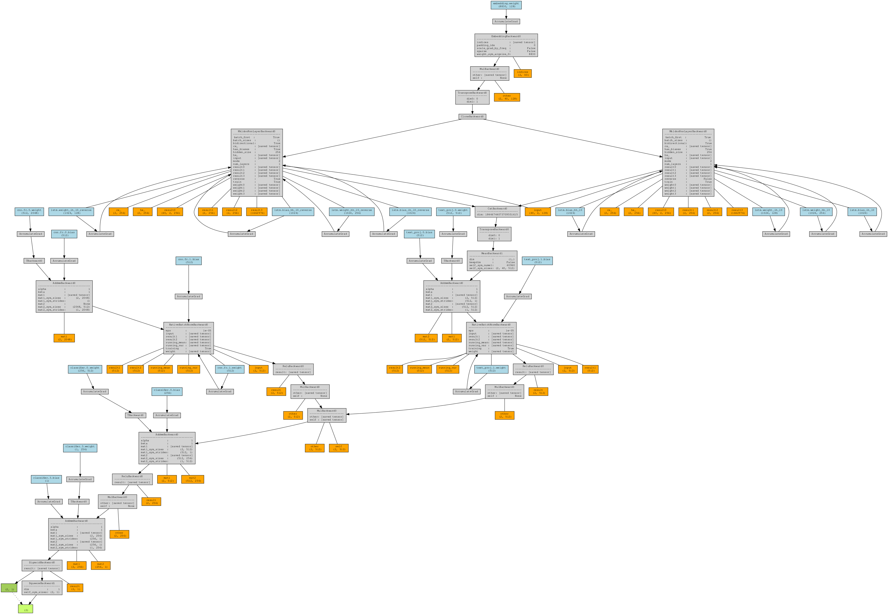

# Deep Learning Fundamentals — Multimodal Image–Text Matching & Polish Sentiment Analysis

This repository contains my coursework and final project for the **Deep Learning Fundamentals (Winter 2025)** course at Lodz University of Technology, implemented in **PyTorch** and **PyTorch Lightning**.

It includes two main machine learning tasks:
1. **[Final Project (`projekt/`)](#final-project-image-text-consistency-challenge)** — A multimodal **Image–Text Consistency** binary classifier combining a pretrained **ResNet50** visual encoder and a **Bidirectional LSTM** text encoder, trained on Flickr8k with custom hard-negative generation (**87.07% validation accuracy**).
2. **[Lab 7 (`lab_7/`)](#lab-7-polish-sentence-sentiment-classification)** — A **PyTorch Lightning** **BiLSTM** sentiment classifier for Polish sentences, including training and inference pipelines.

---

## Repository Structure

```text
.
├── README.md
├── key.txt                                      # Course submission identifier (not used by code)
├── projekt/                                     # Final Project: Image–Text Consistency Challenge
│   ├── dlf-project.ipynb                        # Training & evaluation notebook (Kaggle GPU, Comet ML)
│   ├── model.py                                 # SubmissionModel inference & architecture definition
│   ├── negative_generator.py                    # Synthetic hard & random negative pair generator
│   ├── captions.csv                             # Flickr8k captions (40,455 pairs across 8,091 images)
│   ├── model_architecture.png                   # Auto-generated PyTorch/torchviz computation graph
│   └── Raport.pdf                               # Project technical report (in Polish)
└── lab_7/                                       # Lab 7: Polish Sentiment Classification
    ├── lab_7_polish_sentences.py                # PyTorch Lightning training & inference script
    └── datasets/
        ├── illegal_surveilance_tagged.csv       # Labeled training/validation set (1,670 sentences)
        ├── illegal_surveilance_test_untagged.csv# Unlabeled test set (779 sentences)
        └── illegal_surveilance_predicted.csv    # Generated predictions with probabilities
```

---

## Final Project: Image–Text Consistency Challenge

### Problem & Constraints
Given an `(image, caption)` pair, the model predicts whether the textual description matches the image (`1`) or is inconsistent (`0`).

The project follows **Path A (Classical Multimodal Architecture)**—meaning **no Transformers** and **no pretrained cross-modal models** (such as CLIP or ViT-BERT) were allowed. Both modalities are encoded separately using CNN and RNN backbones and fused via a learned joint representation.

### Dataset & Hard-Negative Engineering
- **Base data (`projekt/captions.csv`)**: Derived from **Flickr8k**, containing **40,455** positive `(image, caption)` pairs across **8,091** unique images (5 captions per image).
- **Balanced pair generation (`projekt/negative_generator.py`)**: Generates a 1:1 balanced dataset (**80,910 total pairs**: 40,455 positive, 40,455 negative) using two negative sampling strategies:
  - **Hard negatives (~85% attempt probability)**: Modifies 1–2 key words in a valid caption using semantic replacement dictionaries across 7 categories—colors (`red` → `green`), numbers/quantities (`one` → `three`), sizes/attributes (`small` → `large`), actions (`running` → `sitting`), animals (`dog` → `cat`), objects (`ball` → `frisbee`), and scenes (`beach` → `mountain`). This forces the model to attend to fine-grained visual details rather than coarse topic mismatch.
  - **Random negatives (~15% probability)**: Pairs an image with a random caption belonging to another image.
- **Leakage-free splitting (`projekt/dlf-project.ipynb`)**: Train/validation splitting (**80% / 20%**) is performed by **unique image ID** (`64,720` training rows / `16,190` validation rows), ensuring all captions and generated negatives for a given image remain in the same split.

### Model Architecture (`projekt/model.py`)
`SubmissionModel` implements late multimodal fusion via element-wise feature interaction:

| Component | Details |
| --- | --- |
| **Image Branch** | Pretrained `ResNet50` (ImageNet weights, frozen convolutional backbone) + trainable projection head: `Linear(2048 → 512) → BatchNorm1d → ReLU → Dropout(0.3)` |
| **Text Branch** | Lowercase alphanumeric tokenization (`max_len=40`, `vocab_size=8,830` capped at `10,000`) → `Embedding(vocab_size, 128, padding_idx=0)` → `Dropout(0.4)` → 1-layer Bidirectional `LSTM(128, 256)` → Mean pooling over sequence → `Linear(512 → 512) → BatchNorm1d → ReLU → Dropout(0.3)` |
| **Multimodal Fusion** | Element-wise multiplication (`img_features * text_features`, 512-dim) |
| **Classifier Head** | `Linear(512 → 256) → ReLU → Dropout(0.3) → Linear(256 → 1) → Sigmoid` |

<details>
<summary>View computation graph (<code>projekt/model_architecture.png</code>)</summary>



</details>

### Training Setup & Results
- **Environment**: Kaggle GPU (P100/T4, per `projekt/Raport.pdf`), tracked with Comet ML (`resnet50_lstm_v5`).
- **Optimization**: `BCELoss`, `Adam` (`lr=5e-4`, `weight_decay=1e-4`), `ReduceLROnPlateau` (`factor=0.5`, `patience=3`), `batch_size=32`, `25` epochs.
- **Data Augmentation (train only)**: `RandomResizedCrop(224, scale=(0.75, 1.0))`, `RandomHorizontalFlip(p=0.5)`, `ColorJitter(0.1, 0.1, 0.1)`, ImageNet normalization.

| Metric | Best Validation Score | Epoch |
| --- | --- | --- |
| **Validation Accuracy** | **87.07%** (`0.8707`) | 24 |
| **Validation F1 Score** | **0.8737** (`0.8736` at Epoch 24) | 19 |
| **Validation Precision / Recall** (at best acc) | **0.8545** / **0.8936** | 24 |
| **Lowest Validation Loss** | **0.3234** | 21 |
| **Training Accuracy** (at best val acc) | **91.14%** | 24 |

> **Note on artifacts**: Due to size constraints, the Flickr8k image files, generated `dataset_with_negatives.csv`, vocabulary artifact (`vocab.pt`), and trained model weights (`weights.pth`) are not committed to this repository.

---

## Lab 7: Polish Sentence Sentiment Classification

### Overview (`lab_7/lab_7_polish_sentences.py`)
A standalone PyTorch Lightning pipeline for binary sentiment classification (`positive` / `negative`) on Polish political and economic commentary sentences.

- **Labeled dataset (`lab_7/datasets/illegal_surveilance_tagged.csv`)**: **1,670** sentences (`945` positive, `725` negative), split 80/20 into training and validation sets.
- **Preprocessing**: Lowercasing, punctuation stripping, whitespace tokenization, sequence padding/truncation to `50` tokens (`MAX_VOCAB_SIZE = 50,000`).
- **Model (`SentimentLSTM`)**:
  - `Embedding(vocab_size, 100)`
  - 2-layer Bidirectional `LSTM` (`hidden_size=128`, `dropout=0.5`)
  - Concatenation of final forward and backward hidden states (`256`-dim) → `Dropout(0.5)` → `Linear(256 → 1)`
  - Trained with `BCEWithLogitsLoss`, `Adam` (`lr=1e-3`), `BinaryAccuracy`, `batch_size=32`, `5` epochs.
- **Inference output (`lab_7/datasets/illegal_surveilance_predicted.csv`)**: Generates sentiment predictions and positive-class probabilities for all **779** sentences in `illegal_surveilance_test_untagged.csv` (`445` predicted positive, `334` predicted negative).

---

## How to Run

### Prerequisites
Install Python dependencies used across the scripts and notebook:

```bash
pip install torch torchvision pytorch-lightning torchmetrics torchinfo pandas numpy scikit-learn pillow matplotlib tqdm comet_ml
```

### Run Lab 7 (Training & Inference)
Run from the **repository root** (paths in the script are relative to root):

```bash
python lab_7/lab_7_polish_sentences.py
```

### Generate Hard Negatives for the Project
Run from inside `projekt/` (uses `captions.csv` in the current directory and writes `dataset_with_negatives.csv`):

```bash
cd projekt
python negative_generator.py
```

To retrain the multimodal classifier, open `projekt/dlf-project.ipynb`, point `IMAGE_DIR` and `CSV_PATH` to your local Flickr8k image folder and `dataset_with_negatives.csv`, and configure `COMET_API_KEY` via an environment variable or secret manager before running.
